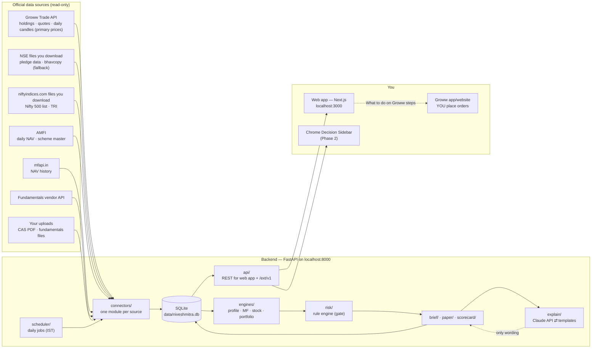

# 01 — System Architecture and Module Breakdown

## 1. Big picture

NiveshMitra runs entirely on **your Windows PC** in Phase 1:

- a **backend** (Python/FastAPI) that collects data, runs the analysis engines and applies risk rules;
- a **web app** (Next.js) you open in your browser at `http://localhost:3000`;
- later, a **Chrome extension** that shows the backend's analysis next to Groww.

It **reads** from official sources and **never places orders**. You place every order yourself on Groww.



Plain-text version:

```
[Official sources] ──► connectors ──► SQLite ──► engines ──► RISK GATE ──► recommendations/briefs ──► web app / extension
                          ▲                                              │
                      scheduler                          explain (Claude API or templates: wording only)
```

## 2. Modules

### Backend (`backend/app/`)

| Package | Responsibility | Phase |
|---|---|---|
| `config.py` | Process settings (paths, ports) | 1 |
| `rules/` | Human-editable rule files: `profile.yaml` (built), `scoring.yaml`, `risk_rules.yaml`, tax/cost tables, SIP scenario assumptions. Each saved result records the rule version + hash in `strategy_versions` | 1 |
| `db/` | SQLAlchemy models (doc 02), session, Alembic migrations, append-only triggers | 1 |
| `security/` | Fernet encryption with the master key in Windows Credential Manager, the secrets store, token hashing | 1 |
| `auth/` | Google Sign-In (ID-token verification), TOTP 2FA, sessions, extension pairing | 1 (pairing 2) |
| `connectors/groww.py` | **Read-only** Groww client: holdings, positions, quotes, candles, instruments. Daily token refresh (§5) | 1 |
| `connectors/nse_files.py` | Parsers for files **you download** from NSE (its terms forbid automated collection): pledged-data CSV (quarterly), bhavcopy (fallback if Groww is down), holiday list | 1 |
| `connectors/niftyindices.py` | Parser for the Nifty 50/200/500 list CSVs **you download** twice a year; optional TRI history files | 1 |
| `connectors/amfi.py` | Daily `NAVAll.txt` (8-column format from 19-Aug-2026) and scheme master CSV | 1 |
| `connectors/mfapi.py` | NAV history backfill, cached | 1 |
| `connectors/fundamentals/` | `base.py` interface → `vendor_<name>.py` (primary) + `manual_upload.py` (fallback). Selected in Settings | 1 |
| `connectors/cas.py` | `casparser` wrapper: parse → preview → manual correction → save. PDF and password discarded | 1 |
| `connectors/amc_disclosures.py` | Monthly portfolio holdings (per-AMC Excel), for overlap | 1 (top AMCs), 2 (rest) |
| `engines/profile.py` | Questionnaire scoring, asset split (doc 03 Part A) | 1 |
| `engines/mf/` | Metrics (rolling returns, Sharpe, Sortino, drawdown, capture), category scoring, portfolio builder, overlap, SIP/goal calculator, monitoring alerts | 1 |
| `engines/stock_lt/` | Exclusions, sector percentiles, scoring, fair value, return ranges, reasons (doc 03 Part B) | 1 |
| `engines/portfolio.py` | Net worth, allocation, P&L, drift, sector/stock concentration | 1 |
| `engines/swing/` | Indicators (pandas-ta-classic / TA-Lib), setups, backtests | 2 |
| `risk/` | Rule engine (doc 04) | 1 |
| `costs_tax/` | Trade cost calculator (brokerage, STT, stamp, GST, DP). Tax estimate before selling | 1 (costs), 2 (tax report) |
| `explain/` | `Explainer` interface → `ClaudeExplainer` / `TemplateExplainer` (§6) | 1 |
| `brief/` | Morning brief, evening summary, weekly MF review | 1 (morning, weekly), 2 (evening full) |
| `paper/` | ₹1,00,000 virtual portfolio, 60-day review | 1 |
| `scorecard/` | Outcome tracking of every recommendation vs Nifty 50 | 1 |
| `alerts/` | In-app alerts. Email (Phase 2), WhatsApp (Phase 3) | 1 |
| `scheduler/` | APScheduler jobs, catch-up after the PC was off | 1 |
| `api/` | FastAPI routers: `/auth`, `/profile`, `/goals`, `/mf`, `/stocks`, `/portfolio`, `/briefs`, `/paper`, `/scorecard`, `/settings`, `/ext/v1` | 1 |

### Web app (`web/`) — Next.js

| Screen | Contents |
|---|---|
| Onboarding | Questionnaire → profile → split → SEBI reality check → paper mode on |
| Dashboard | Net worth, allocation donut, today's P&L, SIP tracker, goal progress, data-health strip, disclaimer |
| Morning brief | Market mood, today's action (or "No action needed"), portfolio health, learning tip |
| Mutual funds | Search, category rankings, fund page (rolling returns, risk, cost, overlap), my portfolio, suggested portfolio |
| Stocks | Screener (ranked shortlist), stock page (score, reasons, fair value, flags), watchlist |
| Goals | Goal planner + SIP calculator (3 scenarios) |
| Paper trading | Virtual portfolio vs Nifty 50 and an index fund |
| Scorecard | Every past recommendation, winners and losers, overrides |
| Learn | Lessons, glossary, concept of the day |
| Settings | Connections (Groww, vendor, Claude), explanation mode, risk parameters, CAS upload, fundamentals upload, language |
| Sectors | `/sectors` overview and `/sectors/{key}`: NSE sector index (chart, 1w/1m/3m) + the tracked companies in that sector grouped by industry. Classification lives in `backend/app/rules/sectors.yaml` (by main business, not NSE's official member list); API `GET /api/market/sectors[/{key}]` |

Every recommendation card has **Explain this simply**, **Why not?** and **What should I do on Groww?**

#### Brand and design system (since 5 Oct 2026)

| Piece | Where | Notes |
|---|---|---|
| Logo files | `web/public/brand/` | Cut from the supplied artwork (`logo-original.webp`): same proportions, transparent background. `logo.png` / `mark.png` are the artwork as supplied; `*-reverse.png` are the same pixels with the navy parts in white, for dark surfaces. `icon-*.png`, `apple-icon.png` and `public/favicon.ico` are the "N" mark at icon sizes |
| Logo component | `web/src/components/Logo.tsx` | Shows the supplied logo in the light theme and the reverse one in the dark theme |
| Colour tokens | `web/src/app/globals.css` | Navy `#001E4A` and emerald `#01854D` sampled from the logo; every other colour is a tint or shade, plus red (losses), amber (cautions) and blue (neutral chart lines). Light and dark sets; text/background pairs checked for WCAG AA |
| Fonts | `web/src/app/layout.tsx` | Outfit for headings, Inter for text and numbers (tabular figures) |
| Shared components | `web/src/components/ui.tsx` | Card, PageHeader, Button, Badge, Notice, StatTile, Segmented, Skeleton, Delta; `ConfirmDialog.tsx` replaces the browser's own confirm box |
| Charts | `web/src/components/LineChart.tsx` | Range buttons, price scale with the latest value tagged, dashed start line, crosshair by mouse, touch or arrow keys. The three split-bar colours are checked for colour-blind safety in both themes |
| Effects | `globals.css` | `.glass`, `.lift`, `.skeleton`, `.nm-enter`; all motion is switched off under `prefers-reduced-motion` |

Gains are green and losses red everywhere, always with ▲ ▼ or + − beside the colour.

### Extension (`extension/`) — Phase 2. See doc 05.

## 3. Data pipelines and daily schedule (IST, trading days)

| Time | Job | Source | Notes |
|---|---|---|---|
| 07:00 | `groww_token_refresh` | Groww | Get a new daily access token via TOTP (§5). On failure → "Reconnect Groww" banner |
| 07:05, 10:30 | `amfi_nav_daily` (re-run) | AMFI | Picks up late NAVs (fund-of-funds are published by 10:00). Every run is idempotent |
| 08:15 | `premarket_context` | Groww | Index closes and trends (Nifty 50, sector indices), VIX if Groww provides it. FII/DII flows only if the fundamentals vendor supplies them |
| 08:30 | `holdings_sync` | Groww | Read-only holdings snapshot |
| **08:45** | **`morning_brief`** | engines | Blocked sections show "Data unavailable" if stale (R-13) |
| 09:15–15:30, every 5 min | `quotes_refresh` | Groww `get_ltp` (≤ 50 symbols/call) | Holdings + watchlist only. Well under the 10/s, 300/min limit |
| **16:00** | **`evening_summary`** | engines | Day P&L, what moved, what to watch |
| 17:30 | `eod_prices` | Groww `get_ohlc` (50 symbols/call → ~10 calls for Nifty 500) | Final daily prices for the whole universe. If Groww is down: last good prices, clearly dated, or a bhavcopy file you upload |
| 22:00, 23:30 | `amfi_nav_daily` → `mf_history_backfill` | AMFI `NAVAll.txt` | Daily NAV for all ~8,600 active schemes, appended to history for downloaded funds. Missed days are filled from AMFI's NAV-history report in one download, or re-fetched from mfapi.in if the gap is over 90 days. Then any fund still missing history is downloaded from mfapi.in (first run: ~1,750 Direct–Growth funds, ~12 minutes) |
| Sunday 08:30 | `groww_instruments` → `stock_universe` → `stock_backfill` → `stock_backtests` | Groww (instrument CSV is public; the rest needs the paid market-data plan) | Stock list; monthly liquidity ranking (≈ 2,700 candle calls, rate-limited); history since 2020; setup backtests |
| Mon–Fri 16:45, 19:00 | `stock_prices_daily` → `stock_intraday` → `trading_after_close` | Groww candles | Latest sessions for the universe, open practice trades, NSE/BSE indices and the BSE tape (a stock whose history Groww re-based after a split or bonus is downloaded again in full); then the newest 15-minute bars; then fill/close practice trades and make the next session's ideas (or "No trade today") |
| after `trading_after_close` | `intraday_practice` | local | Intraday practice: a plan for the next session (market filter verdict, watchlist with levels, beginner rules) and a scoreboard of the session just finished (what each setup and the previous watchlist would have made or lost). Stored in `app_settings` (`intraday_plans`, `intraday_recaps`, last 6 kept) |
| on demand | **Refresh button** (`POST /api/data/refresh`) | Groww, AMFI | Runs `stock_prices_daily` only if a finished session is missing (holiday-aware: `holidays.last_completed_session`), the practice plan if only that is missing, and `amfi_nav_daily` if it last ran over 3 hours ago; always clears the live-quote cache. The page then rebuilds its content so every section re-reads its data. The same "is a finished session missing?" check decides the start-up catch-up |
| Saturday 11:00 | `stock_backtests` | local | Weekly re-test of the setups (skipped if run in the last 5 days) |
| 02:30 | `db_backup` | — | Compact copy via `VACUUM INTO`, last 7 kept. Also runs at start-up if the last one is over 36 h old |
| 22:00 | `recommendation_outcomes` | internal | Updates the scorecard |
| Saturday 10:00 | `weekly_mf_review` | engines | Fund scores, alerts, goal progress, drift |
| Sunday 11:00 | `fundamentals_refresh` | vendor | Weekly; results-season daily |
| Sunday 10:00 | `amfi_ter` → `mf_scoring` | AMFI TER file | Expense ratios (Direct and Regular) for every scheme, then re-score |
| Saturday 07:30 | `mf_scoring` | local | Category scores for ~1,750 Direct-Growth funds (~1 minute); also after new history downloads |
| Sunday 09:00 | `amfi_scheme_master` → `amfi_nav_daily` | AMFI scheme master CSV | Full fund names, launch dates, Direct↔Regular pairing |
| 1st of month | `cas_reminder`, `ter_facts_refresh`, `amc_portfolios` | AMFI/AMCs | Monthly |
| Quarterly | `pledge_upload_reminder` | you → NSE pledged-data CSV | Promoter holding + pledge % for about 1,500 companies, one free file |
| Jan & Jul | `index_list_reminder` | you → niftyindices.com | Upload the new Nifty 500 list (one CSV) |

**Catch-up:** the PC may be off at 08:45, so on start-up the scheduler checks `job_runs` and runs any job that was missed today
(for example, the brief is generated when you switch the PC on at 10:00, marked "generated late at 10:02").

**Stale-data rule:** each source has a freshness limit in `data_source_status`. If it's exceeded, the engines refuse
to recommend, and the UI shows "Data unavailable".

**History backfill (first run):** about 10 years of NAV history from mfapi.in; daily stock prices from Groww candles
(available from 2020, about 6.7 years, which meets the "5+ years for backtests" rule; ~7,000 rate-limited calls ≈ 25 minutes);
fundamentals history from the vendor. This takes a while the first time; progress is shown.

**Manual files (by design):** NSE's terms of use forbid "systematic or automated data collection", so the app never
scrapes nseindia.com or niftyindices.com. For the three NSE files it needs (Nifty 500 list twice a year, pledge data quarterly,
and a bhavcopy only if Groww is down), the app shows a reminder with a link, and you download the file and drop it into the upload box.

## 4. Security

| Area | Measure |
|---|---|
| App login | Google Sign-In: the backend verifies Google's ID token and checks your email against the one allowed email. Then a 6-digit TOTP from an authenticator app (2FA) |
| Network exposure | Backend listens on `127.0.0.1` only, so it can't be reached from other devices on your Wi-Fi |
| Secrets | Groww key/TOTP secret, vendor key and Claude key are **typed by you** into Settings. Encrypted with Fernet; the master key lives in Windows Credential Manager. Never logged or shown again (only the last 4 characters) |
| Passwords | The app never asks for your Groww or Google password. Your CAS password is used once in memory to open the PDF, then discarded |
| Data minimisation | No full PAN stored (last 4 only). CAS PDFs deleted after parsing |
| Audit | Logins, settings changes, overrides and extension calls go to `audit_log` |
| Backups | A nightly compact copy of the database to `data/backups/` (last 7 kept; the database is ~150 MB once fund history is downloaded), plus a copy before every upgrade |

## 5. Groww integration — read-only by construction

- **Auth:** the Groww SDK supports API key + secret (needs daily approval on Groww's site) or **TOTP** (key + TOTP secret, no daily manual step).
  We use TOTP: each morning the backend computes the 6-digit code from your stored TOTP secret and calls
  `GrowwAPI.get_access_token(api_key=<totp token>, totp=<code>)`. Access tokens expire daily. If refresh fails, the app shows
  a clear **"Reconnect Groww"** prompt. Until you reconnect, it shows the last good prices clearly dated, and makes no
new stock recommendations (rule R-13).
- **Read-only guard (three layers):**
  1. `GrowwReadOnlyClient` wraps the SDK object privately and exposes **only**: `holdings()`, `positions()`, `ltp()`,
     `quote()`, `candles()`, `instruments()`, `profile()`.
  2. At start-up, the wrapper replaces every order-related SDK method (`place_order`, `modify_order`, `cancel_order`,
     `create_smart_order`, `modify_smart_order`, `cancel_smart_order`, …) on the private instance with a function that
     raises `ReadOnlyViolation`.
  3. A test scans the whole codebase and fails if any of those names appears outside the guard's own deny-list.
- **Rate limits:** a token-bucket limiter per Groww category: live data 10/s and 300/min; holdings/positions 20/s and 500/min;
  auth 5/s, 30/min and 150/day.
- **Version pin:** `growwapi==1.5.0` (supports Python 3.9–3.13; pins `pandas<3`), which is why the project uses Python 3.12.
- **Terms:** Groww's API terms allow personal/family use only, which matches this app. Data is never republished.

## 6. AI explanation layer — two modes, switchable

```python
class Explainer(Protocol):
    def explain(self, facts: ExplanationFacts, style: Literal["simple", "detailed"], lang: Literal["en", "kn"]) -> Explanation: ...
```

| Mode | How | When |
|---|---|---|
| **Claude API** | Sends only a structured `facts` object: numbers, reasons, flags. No name, email, PAN or account numbers. A system prompt limits Claude to rewording those facts in simple language (and Kannada in Phase 2) | Settings → Explanations → "Claude API", and a key is present |
| **Manual / templates** | Fixed sentence templates filled with the same facts, e.g. *"{name} scores {score}/100. Its return on capital ({roce}) is better than {pct}% of {sector} companies."* | Default when there's no key; also the automatic fallback |

**Numeric guard:** after Claude replies, every number in the text is extracted and checked against the numbers in `facts`
(allowing for formatting such as 12.5% vs 0.125, or ₹1,25,000 vs 125000). If any number doesn't match, the Claude text is discarded
and the template text is shown. `explanation_mode` records which one you saw. The same fallback applies on timeout or API error.

**Cost control:** explanations are generated once per recommendation and cached. There's a monthly spend cap in Settings (default ₹500).

## 7. Local deployment

```
NiveshMitra/
├─ Start NiveshMitra.bat      ← double-click to run backend + web app and open the browser
├─ setup/                     ← one-time setup script (installs Python 3.12 via uv, dependencies, Node packages)
├─ backend/                   ← FastAPI app, tests
├─ web/                       ← Next.js app
├─ extension/                 ← Phase 2
├─ data/                      ← database, backups (git-ignored)
└─ docs/                      ← these documents
```

Optional: a Windows Task Scheduler entry that starts NiveshMitra when you log in, so the 08:45 brief is ready.

## 8. Phase 1 build order (step by step)

1. **Foundation:** project skeleton, one-click setup, database, secrets, login (Google + TOTP).
2. **Onboarding:** questionnaire → risk profile → asset split → SEBI reality check.
3. **Mutual fund data:** AMFI + mfapi.in connectors, scheme master, NAV backfill.
4. **Mutual fund engine:** metrics, category scores, fund page, SIP/goal calculator, suggested portfolio.
5. **CAS import:** upload → parse → correct → holdings. Overlap (top AMCs' disclosures).
6. **Groww read-only connector:** token refresh, holdings sync, quotes; NSE bhavcopy fallback.
7. **Fundamentals:** vendor connector + manual upload; stock engine; stock page; screener.
8. **Risk engine** wired into every recommendation.
9. **Explanations:** templates + Claude API mode + numeric guard.
10. **Dashboard, morning brief, weekly review, scheduler with catch-up.**
11. **Paper trading + scorecard.**

Each step ends with something you can open and use, plus plain-language instructions.

## 9. Verified external facts (checked 2026-09-30; all configurable)

| Fact | Value | Source |
|---|---|---|
| Groww Trade API price | ₹499 + GST/month (≈ ₹589); yearly ₹4,999 + tax; live and historical data need the paid plan | groww.in/trade-api, groww.in/blog/api-trading-on-groww |
| Groww access token | Expires daily; TOTP flow via `pyotp` | groww.in/trade-api/docs/python-sdk |
| Groww price history: two feeds (checked 3-Oct-2026) | **Candle-data feed** (`get_historical_candle_data`): current the same evening, real opens, daily prices already adjusted for splits and bonuses back to 2019 (≤ 1,080 days per request); 15-minute bars for ~3 months only (≤ 30 days per request, volume is the day's running total). The SDK calls it deprecated, but it is the only current feed, so daily candles and the newest 15-minute bars come from it. **Backtesting feed** (`get_historical_candles`): 15-minute bars from 2020, but it runs days behind, its newest sessions can be incomplete, it is not adjusted, daily opens are empty and daily volume is double-counted — used only for old 15-minute history | tested against the live API; `connectors/groww.py` |
| NSE/BSE trading holidays 2026 | 16 weekday holidays + Muhurat session on Sun 8-Nov; kept in `rules/market_holidays.yaml` (add next year's list each December). Jan–Sep confirmed against the days the Nifty actually traded | zerodha.com/marketintel/holiday-calendar |
| AMFI NAV file | `https://portal.amfiindia.com/spages/NAVAll.txt`, `;`-separated, **8 columns since 19-Aug-2026** | amfiindia.com/net-asset-value/nav-download |
| CAS parsing | `casparser` 1.4.1 (MIT). Supports **CAMS / KFintech** and **NSDL / CDSL** CAS. **Not MF Central** statements | pypi.org/project/casparser |
| Equity STCG / LTCG | 20% / 12.5% above ₹1.25 lakh per year (unchanged in Budgets 2025 and 2026) | Budget 2024–2026 |
| STT (delivery) | 0.1% on buy and sell | taxguru.in |
| Stamp duty (delivery buy) | 0.015% | zerodha.com/charges |
| NSE transaction charge | 0.00297% (+ IPFT 0.0001%) | NSE circular FA64232 |
| SEBI turnover fee | ₹10 per crore | — |
| Groww delivery brokerage | ₹20 or 0.1% per order, whichever is lower (min ₹5); DP ≈ ₹23.6 per sell per scrip per day | groww.in/pricing |
| SEBI F&O study (Aug 2026) | **87.7%** of individual F&O traders lost money in FY26 (90.9% in FY25); average loss ≈ ₹1.17 lakh | SEBI PR 50/2026 |
| SEBI intraday study (Jul 2024, FY23 data) | **Over 70%** of individual intraday traders made losses (80% of those making > 500 trades/yr) | SEBI study, 24-Jul-2024 |
| Technical indicators (Phase 2) | `pandas-ta` is unmaintained → use `pandas-ta-classic` or `TA-Lib` (Windows wheels available) | PyPI |
| NSE terms of use | "Systematic or automated data collection" prohibited; files offered for download may be downloaded manually | nseindia.com/static/nse-terms-of-use |
| NSE pledged data | Free CSV download: promoter holding, % encumbered, % pledged, about 1,500 companies | nseindia.com → Corporate filings → Pledged data |
| Income-tax Act 2025 | In force from 1-Apr-2026; section numbers (e.g. old "80C") are renumbered. The app will use the new references when the tax module is built | — |

## 10. Compliance

- Personal decision-support tool; **not** a SEBI-registered Investment Adviser or Research Analyst. Offering it to others would require registration.
- The disclaimer appears on the dashboard, every recommendation and the extension: *"Investments are subject to market risks. Past performance does not guarantee future returns. Final decisions are yours."*
- Each data source is used within its terms: personal, non-commercial, no redistribution, rate limits respected.
