# 02 — Database Schema

**Phase 1:** SQLite, a single file at `data/niveshmitra.db` on your PC.
**Later:** PostgreSQL + TimescaleDB. The schema is written with SQLAlchemy using portable types, and Alembic
migrations let the same models move to Postgres unchanged. Tables marked ⏱ become TimescaleDB hypertables then.

## Conventions

- Money: `NUMERIC(18,4)`, handled as Python `Decimal` (never float for rupees).
- Percentages are stored as fractions (0.125 = 12.5%).
- Timestamps are stored in UTC and shown in IST.
- `source` columns record where each number came from (`groww`, `nse_bhavcopy`, `amfi`, `mfapi`, `vendor:<name>`, `manual`, `cas`).
- Secrets are **never** stored in plain text (see `secrets`). Your CAS PDF and its password are **never** stored.
- Recommendations, risk checks and overrides are **append-only**: database triggers reject `DELETE`
  (and `UPDATE` of the original fields), so losing picks can't disappear.

## Entity overview

```mermaid
erDiagram
    users ||--o{ sessions : has
    users ||--o{ risk_profiles : answers
    risk_profiles ||--|| allocation_targets : produces
    users ||--o{ goals : sets
    goals ||--o{ goal_sips : funded_by
    instruments ||--o{ price_daily : has
    instruments ||--o{ fundamentals_annual : has
    instruments ||--o{ shareholding : has
    instruments ||--o{ corporate_flags : has
    mf_schemes ||--o{ nav_daily : has
    mf_schemes ||--o{ mf_scheme_facts : has
    mf_schemes ||--o{ mf_portfolio_holdings : discloses
    accounts ||--o{ stock_holdings : holds
    accounts ||--o{ stock_transactions : records
    accounts ||--o{ mf_folios : holds
    mf_folios ||--o{ mf_holdings : holds
    mf_folios ||--o{ mf_transactions : records
    strategy_versions ||--o{ score_runs : used_by
    score_runs ||--o{ stock_scores : produces
    score_runs ||--o{ fund_scores : produces
    recommendations ||--o{ recommendation_outcomes : tracked_by
    recommendations ||--|| risk_checks : gated_by
    risk_checks ||--o{ risk_overrides : may_have
    paper_portfolios ||--o{ paper_trades : has
```

---

## 1. Identity, settings, secrets

| Table | Columns | Notes |
|---|---|---|
| `users` | id PK, google_sub UNIQUE, email, display_name, totp_secret_enc, totp_enabled, language (`en`/`kn`), created_at, last_login_at | One row (personal app), but modelled properly |
| `sessions` | id PK, user_id FK, token_hash, kind (`web`/`extension`), scopes, created_at, expires_at, revoked_at, user_agent | Only a SHA-256 hash of each token is stored |
| `extension_pairings` | id PK, code_hash, created_at, expires_at, used_at | 6-digit one-time code to pair the Chrome extension (doc 05) |
| `app_settings` | key PK, value_json, updated_at, effective_at | `effective_at` enforces the 24-hour delay for loosened risk settings |
| `secrets` | name PK, ciphertext, updated_at | Groww API key/secret/access token, vendor key, Claude key. Encrypted with Fernet; the master key lives in **Windows Credential Manager** via `keyring`, never in the DB or the repo |
| `audit_log` | id PK, ts, actor, action, detail_json | Logins, settings changes, overrides, extension calls |

## 2. Profile and goals

| Table | Columns |
|---|---|
| `risk_profiles` | id PK, user_id FK, answers_json, capacity_score, tolerance_category, final_category, reasons_json, created_at, review_due_on, is_current |
| `allocation_targets` | id PK, profile_id FK, core_pct, satellite_pct, trading_pct, emergency_fund_target, is_user_override, warnings_json, created_at, effective_at |
| `goals` | id PK, user_id FK, name, goal_type, target_amount_today, inflation_rate, target_year, current_corpus, priority, created_at, archived_at |
| `goal_sips` | goal_id FK, scheme_code FK, monthly_amount, step_up_pct |

## 3. Reference data

| Table | Columns | Notes |
|---|---|---|
| `instruments` | id PK, isin UNIQUE, nse_symbol, bse_code, groww_symbol, name, sector, industry, mcap_bucket, series, is_active, listing_date, updated_at | Master list of stocks |
| `index_membership` | index_name, isin, weight, as_of — PK(index_name, isin, as_of) | Nifty 50/200/500 lists |
| `groww_slug_map` | slug PK, kind (`stock`/`mf`), isin, scheme_code, confidence, confirmed_by_user, created_at | Maps Groww URL slugs → instruments for the extension |
| `mf_schemes` ✅ | scheme_code PK (AMFI code), amc, fund_name, display_name (AMFI's full NAV name), plan (`direct`/`regular`/`unknown`), option (`growth`/`idcw`/`bonus`), option_detail, scheme_type, asset_class, category (normalised by `rules/mf_categories.yaml`), raw_category, isin_growth, isin_reinvest, launch_date, variant_key, twin_scheme_code, latest_nav, latest_nav_date, is_active, tracked, history_start / history_end / history_synced_at / history_error | `tracked` = active, open-ended, Direct–Growth funds, whose full history is downloaded. `twin_scheme_code` links Direct ↔ Regular. Benchmark index is added in step 4 |
| `mf_scheme_facts` | scheme_code FK, as_of, ter, aum_cr, exit_load_text, exit_load_days, fund_manager, manager_since, source — PK(scheme_code, as_of) | Monthly snapshots → manager-change and TER alerts |
| `mf_portfolio_holdings` | scheme_code FK, as_of, isin, security_name, weight, asset_type, rating — PK(scheme_code, as_of, isin) | Monthly disclosures → overlap, credit quality |
| `market_holidays` | date PK, exchange, description | Seeded each year from NSE's holiday list |
| `tax_config` | key, value, effective_from — PK(key, effective_from) | e.g. `stcg_equity_rate = 0.20` from 2024-07-23. Rates are versioned, never hard-coded |
| `cost_config` | key, value, effective_from | Brokerage, STT, exchange txn, SEBI fee, stamp duty, GST, DP charge |

## 4. Time series ⏱

| Table | Columns | Notes |
|---|---|---|
| `price_daily` ⏱ | instrument_id FK, date, open, high, low, close, volume, traded_value, source — PK(instrument_id, date) | From Groww candles or NSE bhavcopy |
| `quote_latest` | instrument_id PK, ltp, change_pct, ts, source | Overwritten during market hours; no history |
| `index_daily` ⏱ | index_name, date, open, high, low, close, is_tri — PK(index_name, date, is_tri) | Nifty 50, sector indices, benchmark TRIs |
| `nav_daily` ⏱ ✅ | scheme_code FK, date, nav — PK(scheme_code, date), `WITHOUT ROWID` (~32 bytes/row) | From AMFI (daily + missed-day fill) and mfapi.in (history). ~4.4 million rows ≈ 143 MB |
| `market_context_daily` | date PK, india_vix, fii_net_cr, dii_net_cr, advances, declines, mood, mood_reason | Morning brief "market mood" |

## 5. Fundamentals and events

| Table | Columns |
|---|---|
| `fundamentals_annual` | instrument_id FK, fiscal_year, revenue, ebitda, ebit, pat, eps, total_assets, total_equity, total_debt, cash, cfo, capex, fcf, interest, shares_out, gross_npa_pct, car_pct, source, fetched_at — PK(instrument_id, fiscal_year, source) |
| `fundamentals_quarterly` | instrument_id FK, quarter_end, revenue, ebit, pat, eps, source, fetched_at — PK(instrument_id, quarter_end, source) |
| `shareholding` | instrument_id FK, quarter_end, promoter_pct, promoter_pledged_pct, fii_pct, dii_pct, public_pct, source — PK(instrument_id, quarter_end) |
| `corporate_flags` | id PK, instrument_id FK, flag_code (E4/E5/…), severity, detail, source_url, detected_at, cleared_at |
| `corporate_events` | id PK, instrument_id FK, event_type (`results`/`dividend`/`split`/`bonus`/`agm`), event_date, detail |
| `news_items` | id PK, instrument_id FK NULL, published_at, source, title, url, summary, sentiment, summary_mode (`llm`/`template`) |
| `fundamentals_uploads` | id PK, uploaded_at, filename, file_hash, provider (`manual:screener`/…), rows_parsed, warnings_json |

**Provider precedence:** when both the vendor and a manual upload have a value, the vendor is used unless you
have marked that stock "prefer manual". The chosen source is shown on every number.

## 6. Portfolio

| Table | Columns | Notes |
|---|---|---|
| `accounts` | id PK, kind (`groww_demat`/`mf`/`paper`/`manual`), name | |
| `stock_holdings` | account_id FK, instrument_id FK, qty, avg_price, as_of, source — PK(account_id, instrument_id, as_of) | Snapshots from the Groww read-only sync |
| `stock_transactions` | id PK, account_id FK, instrument_id FK, trade_date, side, qty, price, charges_json, bucket (`satellite`/`trading`), recommendation_id FK NULL, source, note | You log trades, or they are inferred from holdings changes |
| `mf_folios` | id PK, account_id FK, amc, folio_no, pan_last4 | Full PAN never stored |
| `mf_holdings` | folio_id FK, scheme_code FK, units, cost_value, as_of, source — PK(folio_id, scheme_code, as_of) | From CAS or manual entry |
| `mf_transactions` | id PK, folio_id FK, scheme_code FK, date, txn_type, amount, units, nav, source, cas_import_id FK NULL | |
| `sips` | id PK, folio_id FK, scheme_code FK, amount, day_of_month, start_date, active, goal_id FK NULL | |
| `cas_imports` | id PK, uploaded_at, file_hash, statement_from, statement_to, cas_type, status, parse_warnings_json, corrections_json | Parsed results only; the PDF is deleted after parsing |
| `portfolio_daily` ⏱ | date, account_id, invested, market_value, day_pnl — PK(date, account_id) | Dashboard charts |
| `watchlist` | id PK, instrument_id NULL, scheme_code NULL, added_at, alert_above, alert_below, alert_on_results, note | |

## 7. Engines, recommendations, scorecard

| Table | Columns | Notes |
|---|---|---|
| `strategy_versions` | id PK, engine (`stock_lt`/`mf`/`swing`/`profile`), version, config_json, created_at, notes | Snapshot of the scoring YAML used |
| `score_runs` | id PK, engine, strategy_version_id FK, run_at, data_as_of, universe_size, status, error | |
| `stock_scores` | run_id FK, instrument_id FK, total, components_json, penalties_json, excluded_code, confidence, fv_low, fv_mid, fv_high, buy_low, buy_high, ret_cons, ret_exp, ret_opt, reasons_for_json, reasons_against_json — PK(run_id, instrument_id) | |
| `fund_scores` | run_id FK, scheme_code FK, total, components_json, metrics_json, rank_in_category, category_size, confidence — PK(run_id, scheme_code) | |
| `recommendations` 🔒 | id PK, created_at, engine, instrument_id NULL, scheme_code NULL, action, confidence, entry_low, entry_high, stop_loss, target, horizon_days, qty, amount, rationale_json, risks_json, groww_steps_json, explanation_text, explanation_mode, strategy_version_id FK, data_as_of, risk_check_id FK, is_paper, status (`open`/`closed`/`expired`) | 🔒 append-only; only `status` may change |
| `recommendation_outcomes` | id PK, recommendation_id FK, evaluated_on, horizon_label (`1m`/`3m`/`6m`/`1y`/`closed`), price_then, price_now, return_pct, benchmark_return_pct, hit, closed_reason | Filled by a nightly job; used by the Scorecard |
| `user_actions` | id PK, recommendation_id FK, action (`followed`/`ignored`/`partial`), logged_at, note | "Did I act on it?" |
| `briefs` | id PK, kind (`morning`/`evening`/`weekly`), for_date, generated_at, content_json, explanation_mode, data_health_json | |
| `alerts` | id PK, kind, subject, message, severity, created_at, read_at, channels_json | |

## 8. Risk engine (doc 04)

| Table | Columns | Notes |
|---|---|---|
| `risk_rules` | code PK, description, params_json, severity, enabled, overridable, locked, updated_at | `locked` rules can't be disabled |
| `risk_checks` 🔒 | id PK, context (`recommendation`/`extension_preview`/`manual_trade`/`settings`), subject_json, checked_at, overall, findings_json, adjusted_qty | |
| `risk_overrides` 🔒 | id PK, risk_check_id FK, rule_code, reason_text, acknowledged_at | |
| `trading_day_state` | date PK, realised_pnl, open_pnl, loss_limit_hit, consecutive_losses, cooling_off_until | |

## 9. Paper trading

| Table | Columns |
|---|---|
| `paper_portfolios` | id PK, name, start_date, start_capital (default ₹1,00,000), review_on (start + 60 days), status |
| `paper_trades` | id PK, portfolio_id FK, recommendation_id FK, instrument_id NULL, scheme_code NULL, side, date, qty_or_units, price, charges_json |
| `paper_positions` | portfolio_id FK, instrument_id NULL, scheme_code NULL, qty_or_units, avg_cost — PK(portfolio_id, instrument_id, scheme_code) |
| `paper_daily` ⏱ | portfolio_id FK, date, value, nifty50_value, index_fund_value — PK(portfolio_id, date) |

Comparisons use a Nifty 50 TRI line and a "₹1,00,000 in a Nifty 50 index fund" line with that fund's actual TER, both after costs.

## 10. Operations

| Table | Columns | Notes |
|---|---|---|
| `data_source_status` | source PK, last_attempt_at, last_success_at, last_error, freshness_sla_minutes, healthy | Feeds rule R-13 and the "Data health" panel |
| `job_runs` | id PK, job_name, scheduled_for, started_at, finished_at, status, detail | Lets the app catch up on jobs missed while the PC was off |
| `learning_content` | id PK, kind (`lesson`/`glossary`/`tip`), slug, title_en, body_en, title_kn, body_kn | Seeded from files |
